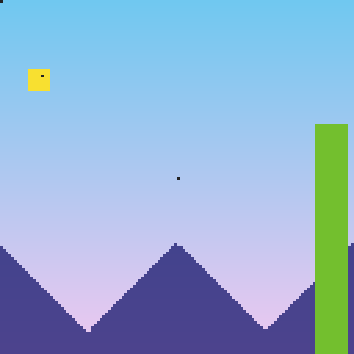
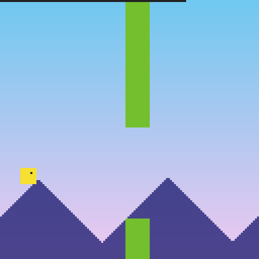

# flappy bird in 256 bytes (WebAssembly)

**[▶ Play it here](https://chamuditha4.github.io/flappy-bird/)**

GitHub strips scripts from READMEs, so the game can't run inline. The link above opens the same `index.html` on GitHub Pages.

The whole game is `flappy.wasm`, hand-assembled to 252 bytes. It starts paused with a dot in the middle of the screen. Press any key or click to flap. The dark bar along the top is your distance, 8 pixels per pipe. Behind the pipes is a sky that fades to pink at the horizon, with mountains scrolling at a quarter of the pipe speed. Dying reboots to the start screen.

    node build.js          # writes flappy.wasm and index.html
    open index.html        # wasm is inlined as base64, so file:// works

`index.html` only holds the glue: key handler, `putImageData`, a 20 Hz timer. Everything you see, including the start dot, the score bar, the sky and the mountains, is drawn by the wasm.

Tricks, borrowed from hill-climb-1024:

- **Hand-assembled.** `build.js` emits raw bytes. There is no name section, one type, one function, and constants picked so their LEBs stay short.
- **Memory is the screen.** One 64 KiB page is exactly 128x128 RGBA. The host wraps it in an `ImageData` with no copy.
- **State lives in three globals.** They are bird position, velocity and distance flown. The score is not stored: it is `distance >> 9`, the number of times the pipe has wrapped.
- **The loop walks byte addresses.** It steps `i += 4`, so `i >> 9` is y, and the store needs no shift. x is never computed on its own: anything that needs it adds to `i` and masks the result.
- **Pipe wrap is free.** `(distance + i) & 511 > 463` makes the pipe slide in and out of both screen edges with no spawn or despawn logic.
- **The gap is one unsigned compare.** `(y - gap) > 44` is true both above and below the gap.
- **The gap position comes from the score.** `((distance >> 9) * 29) & 63`, so no RNG or extra state.
- **Collision uses the rendering.** The bird and pipe flags are `tee`d straight into an `and` in the draw loop.
- **The bird is one mask.** The bird's position is stored as a pixel address, so `r = i - bird` has dy in bits 9-11 and dx in bits 0-4. The pixel is part of the 8x8 bird exactly when `r & ~0xE1F == 0`. The eye is `r == 1044`. There is no separate hit test.
- **Off-screen is one unsigned compare.** `bird >> 16` is non-zero both above the top (negative) and below the bottom (past 64 KiB). It is OR'd into the collision test, so one trap serves both.
- **The loop ends on `i << 16`.** It is zero only when `i` reaches 65536, so `br_if` needs no compare.
- **The memory is exported as `""`.** A zero-length name saves a byte.
- **Death is `unreachable`.** The trap throws, and the host reboots a fresh instance. That is the wasm version of `jmp start`.
- **Dark pixels are transparent.** Colour `0` costs 2 bytes and has alpha 0, so the dark page shows through. The eye, the score bar and the start dot all share that one `select`.
- **The score bar is one compare.** `i <= distance >> 4`. It grows as you fly and wraps onto the next row after 16 pipes.
- **Mountains are a triangle wave.** `i32.extend8_s` turns the low byte of `distance/4 + i` into -128..127 with no mask, and `s ^ (s >> 31)` folds it into a triangle. The pixel is a mountain when `i - |s|*128 > row 88`, using a signed compare so the top rows don't wrap.
- **Mountain colour is a shift.** The mountain flag (0 or 1) is the shift amount: `sky >> mountain`. One byte halves the colour and the alpha, so the mountains are the sky darkened against the page, gradient included.
- **The sky gradient is an add.** `sky + y` raises only the red byte, so the sky turns pink towards the horizon.
- **The start dot is the key.** The host calls `f(DOT)` once, where `DOT` is the byte address of the screen centre. Any non-zero key flaps, so physics still runs, and `i == key` lights that one pixel. In play the key is 0 or 1, and those addresses are already covered by the score bar. That costs 6 bytes.
- **Colours that encode short.** The sky has blue ≥ 0xF0, which saves a byte of LEB.
